<p align="center">
  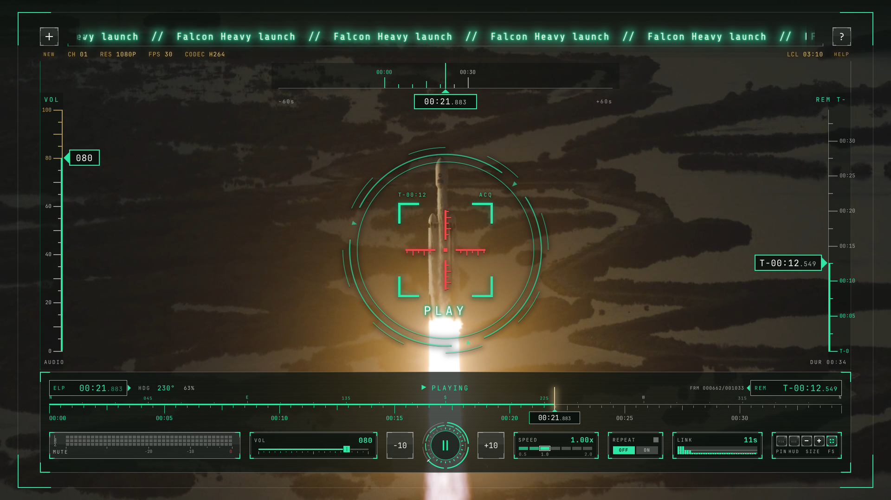
</p>

<h1 align="center">OmaRaptor Player</h1>

<p align="center"><b>A free, open-source, super-light player for almost any video link on the web. No login, no browser, and a fully working HUD inspired by the F-22 Raptor.</b></p>

<p align="center">
  <a href="https://github.com/KarPage/omaraptor-player/releases/latest">Download</a> ·
  <a href="#install">Install</a> ·
  <a href="#keys">Keys</a> ·
  <a href="#supported-sites">Supported sites</a> ·
  <a href="https://omaraptor.vercel.app">Website</a>
</p>

Copy a link, press <kbd>Super</kbd>+<kbd>Alt</kbd>+<kbd>Y</kbd>, press FIRE, and the video plays in a frameless, pinned 16:9 window. The first player opens in the middle of the screen; more players park in the free corners. It is mpv and yt-dlp underneath, so it starts fast, uses hardware decoding and stays light on battery. Built for [Omarchy](https://omarchy.org) on Hyprland.

<p align="center">
  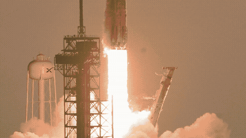
  <br><a href="https://github.com/KarPage/omaraptor-player/releases/latest/download/omaraptor-demo-1080p.mp4">Watch the 1080p demo with sound</a>
</p>

## Features

- **Plays almost any link.** YouTube, X, Twitch, TikTok, Instagram, Dailymotion, Streamable, direct video files and HLS streams, plus live streams and webcams.
- **No login, no browser.** Nothing to sign in to and no web page running behind the video.
- **ARMED, then FIRE.** A copied link loads paused in a launch console with a gauge cluster (signal, buffer, MASTER ARM, SEEKER, RELEASE). Press FIRE (click, <kbd>Enter</kbd> or <kbd>Space</kbd>) for a short countdown and the picture expands into the HUD. <kbd>Esc</kbd> goes back to the paste screen.
- **A HUD that works.** Every gauge is live: elapsed and remaining time, the seek tape, volume, speed, repeat, link status and a real audio signal meter that keeps reading while muted.
- **CRUISE and COMBAT.** CRUISE is a bare player with a slim bar. COMBAT is the full cockpit. Press <kbd>H</kbd> or the HUD tile for the MASTER ARM panel.
- **Fullscreen cockpit.** Fullscreen adds a heading tape, VOL and REM side tapes, a top time box and a scope that locks on the picture when you pause.
- **End-of-video ramp.** The timers turn amber, then red, and a NEXT card shows what plays next.
- **Progress ring** around the play button, 24 ticks from twelve o'clock.
- **PIN mode.** The frame and bar stay up as a living frame. Press <kbd>P</kbd> or the PIN tile.
- **LIVE mode** for streams with no end: the ring and timers switch to a live readout. In fullscreen the right tape shows how far you are behind the live edge.
- **Key hints on demand.** Press `?` for every key. Its KEY HINTS switch (or `T`) shows the key letters on the buttons at once. They are off by default.
- **Many players at once.** Each link opens its own window in a free corner. The `+` button opens an empty NO SIGNAL / PASTE LINK player centred over the one you clicked. Size, move, fullscreen and close any of them from the keyboard, even when another app has focus.
- **Keyboard first.** Seek by 5 or 10 seconds or jump to 0 to 90 % with the number keys, change speed, repeat, show the link. A key card on the first launch shows the basics, and <kbd>?</kbd> opens every key and mouse action.
- **Up next.** Playlists play through. Single YouTube videos continue with the up-next mix, and YouTube Mix links start at once with their video.

## Screenshots

All footage is licensed open content (see [Credits](#credits)). Nothing personal is on screen.

<a href="screenshots/01-home.png">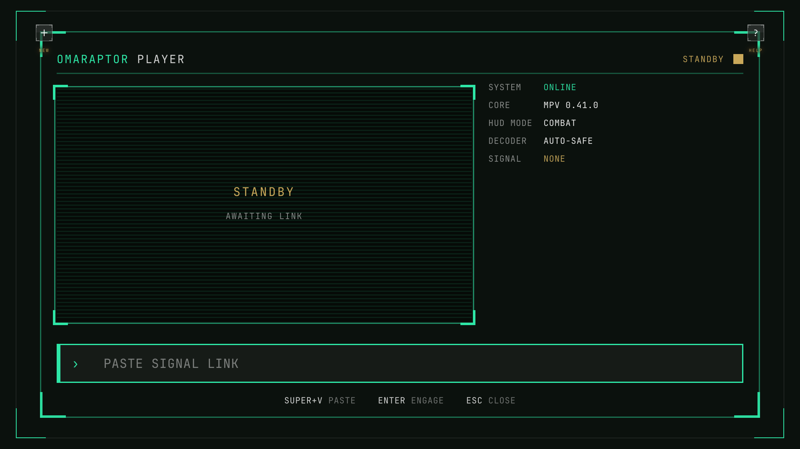</a>
<a href="screenshots/02-cruise.png">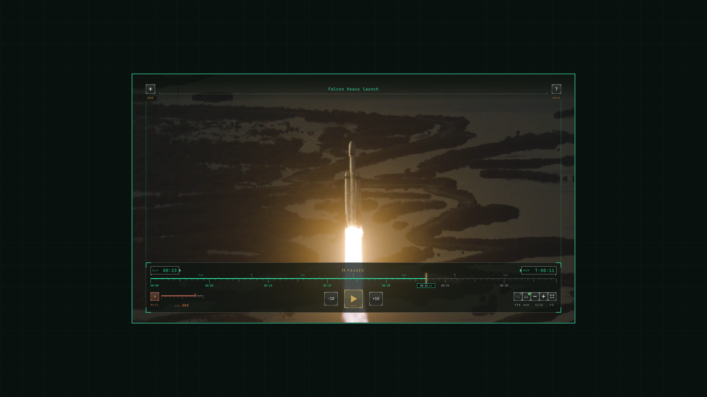</a>
<a href="screenshots/03-combat.png">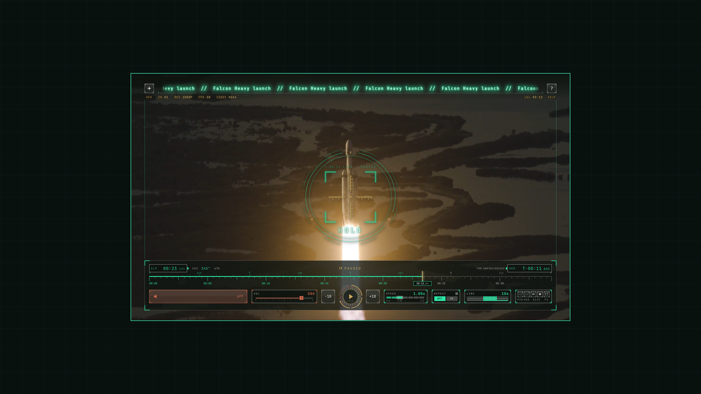</a>
<a href="screenshots/04-master-arm.png">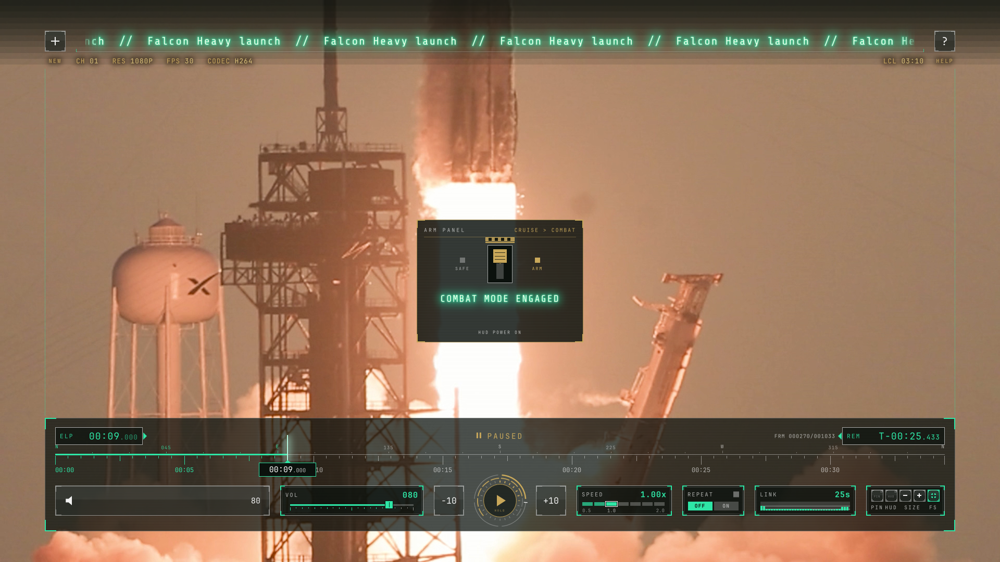</a>
<a href="screenshots/05-end-ramp.png">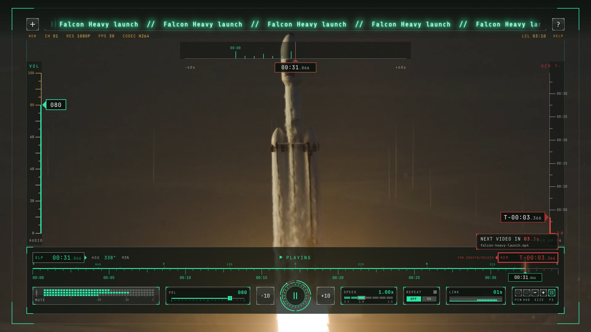</a>
<a href="screenshots/06-ring.png">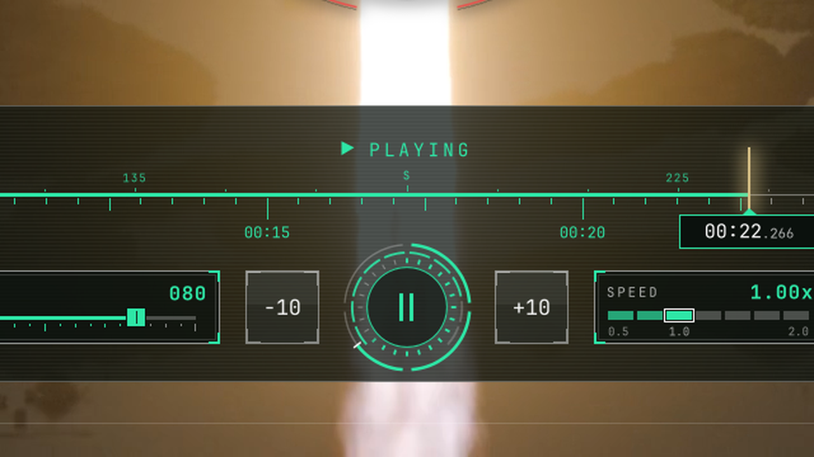</a>
<a href="screenshots/07-signal-live.png">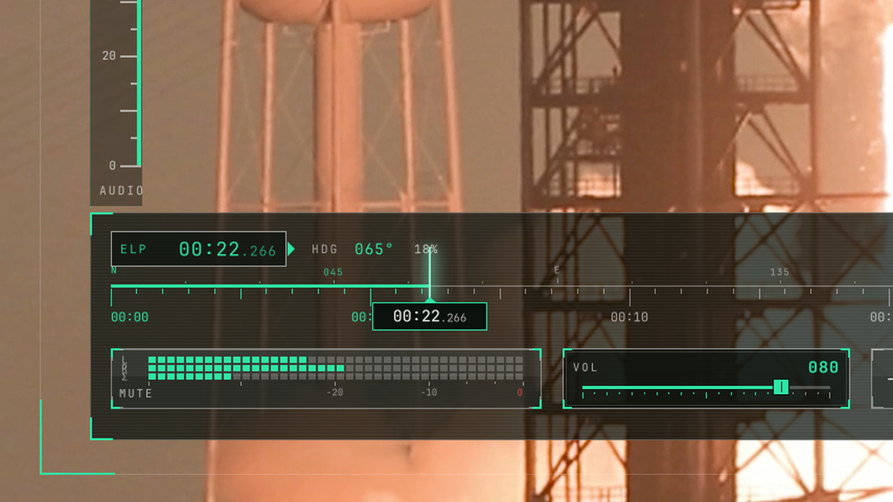</a>
<a href="screenshots/08-signal-muted.png">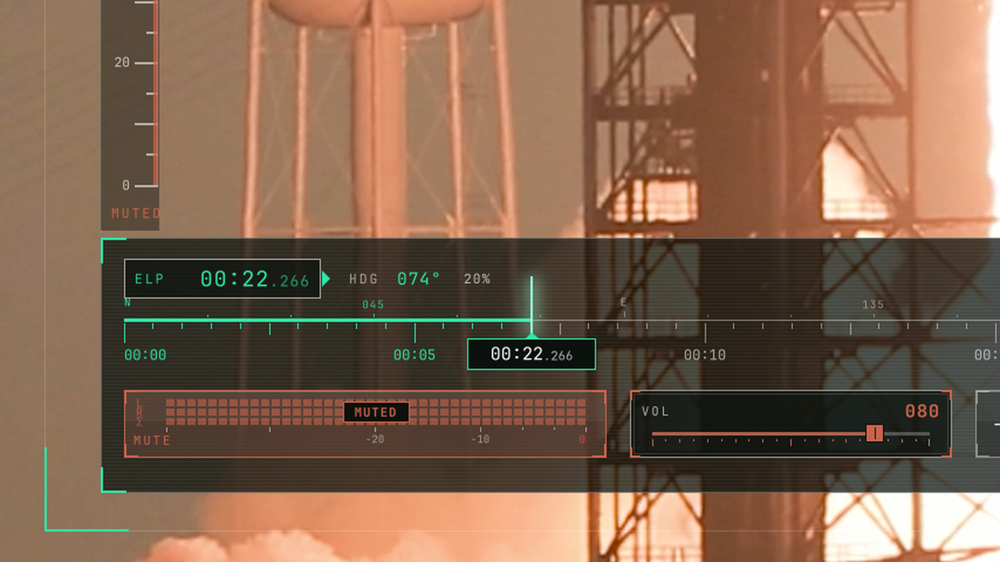</a>
<a href="screenshots/09-pin.png">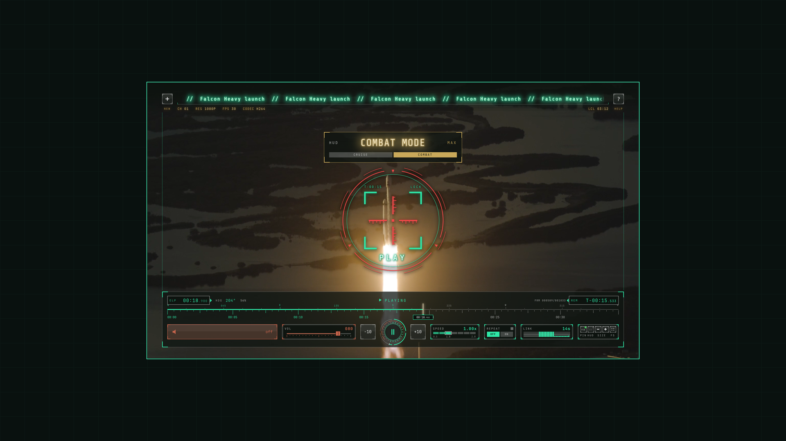</a>
<a href="screenshots/10-help.png">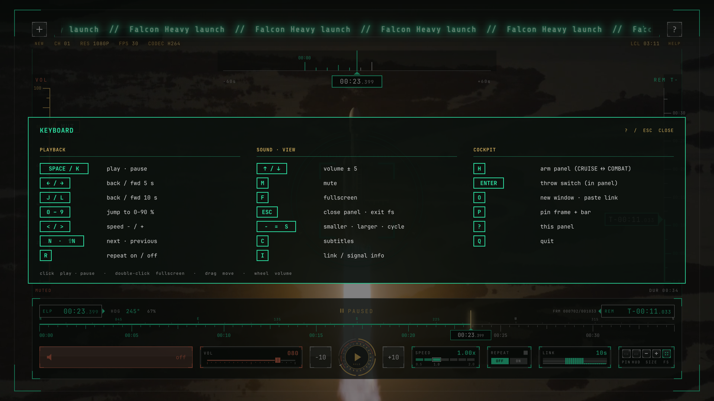</a>
<a href="screenshots/11-live.png">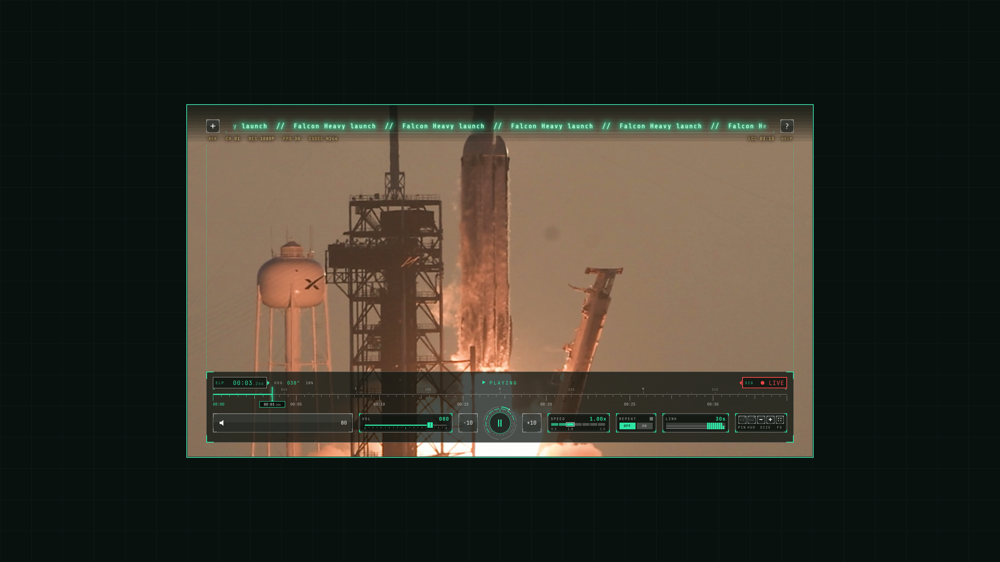</a>
<a href="screenshots/12-sizes.png">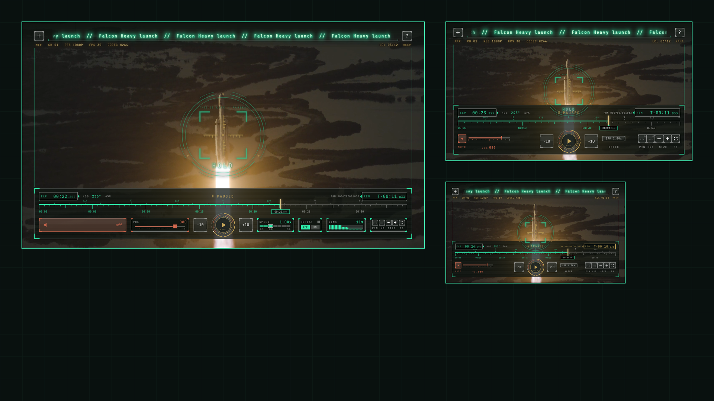</a>

## Install

### As an Omarchy plugin

```sh
omarchy plugin add https://github.com/KarPage/omaraptor-player --enable
```

This adds a video button to your bar. Left-click plays the copied link, right-click opens an empty player that asks for a link, and middle-click closes every player. The first click opens a terminal with the installer from the plugin folder (the same `./install.sh` as below), which asks before it adds its one line to your Hyprland config. Later plugin updates reinstall quietly. If the button doesn't show up, add **OmaRaptor Player** to the bar from the bar settings.

### From the repository

```sh
git clone https://github.com/KarPage/omaraptor-player && cd omaraptor-player && ./install.sh
```

The installer puts `omaraptor` in `~/.local/bin`, the player config in `~/.config/omaraptor`, and window rules and key binds in `~/.config/hypr/omaraptor.lua`. It asks before it adds one line, `require("hypr.omaraptor")`, to `~/.config/hypr/hyprland.lua`, and it backs that file up first. Every file it replaces gets a `.bak-omaraptor-<time>` copy. Your own `script-opts` are kept on update. Nothing is downloaded and nothing runs as root.

You need `mpv`, `yt-dlp`, `socat`, `jq`, `wl-clipboard` and `hyprctl`. On Omarchy:

```sh
sudo pacman -S --needed mpv yt-dlp socat jq wl-clipboard
```

### Remove

```sh
./uninstall.sh            # keeps your settings in ~/.config/omaraptor
./uninstall.sh --purge    # removes them too
```

If you added the plugin, run its uninstaller first, then remove the plugin:

```sh
~/.config/omarchy/plugins/io.github.karpage.omaraptor/uninstall.sh
omarchy plugin remove io.github.karpage.omaraptor
```

The uninstaller removes only the files it installed and the one `require` line. It never stops a running player, and it refuses any path that does not resolve inside your home folder.

## Keys

<!-- keymap -->
### Anywhere (Hyprland binds)

| Keys | Action |
|---|---|
| <kbd>Super</kbd>+<kbd>Alt</kbd>+<kbd>Y</kbd> | Play copied link in a new window (mpv) |
| <kbd>Super</kbd>+<kbd>Ctrl</kbd>+<kbd>Alt</kbd>+<kbd>N</kbd> | New empty window (paste a link) |
| <kbd>Super</kbd>+<kbd>Ctrl</kbd>+<kbd>Alt</kbd>+<kbd>V</kbd> | Swap video in current player |
| <kbd>Super</kbd>+<kbd>Alt</kbd>+<kbd>W</kbd> | Float focused YouTube window (toggle) |
| <kbd>Super</kbd>+<kbd>Alt</kbd>+<kbd>Shift</kbd>+<kbd>Y</kbd> | Close |
| <kbd>Super</kbd>+<kbd>Ctrl</kbd>+<kbd>Alt</kbd>+<kbd>Y</kbd> | Next corner |
| <kbd>Super</kbd>+<kbd>Ctrl</kbd>+<kbd>Alt</kbd>+<kbd>]</kbd> | Bigger |
| <kbd>Super</kbd>+<kbd>Ctrl</kbd>+<kbd>Alt</kbd>+<kbd>[</kbd> | Smaller |
| <kbd>Super</kbd>+<kbd>Ctrl</kbd>+<kbd>Alt</kbd>+<kbd>S</kbd> | Cycle small / medium / large |
| <kbd>Super</kbd>+<kbd>Ctrl</kbd>+<kbd>Alt</kbd>+<kbd>←</kbd> | Move left |
| <kbd>Super</kbd>+<kbd>Ctrl</kbd>+<kbd>Alt</kbd>+<kbd>→</kbd> | Move right |
| <kbd>Super</kbd>+<kbd>Ctrl</kbd>+<kbd>Alt</kbd>+<kbd>↑</kbd> | Move up |
| <kbd>Super</kbd>+<kbd>Ctrl</kbd>+<kbd>Alt</kbd>+<kbd>↓</kbd> | Move down |
| <kbd>Super</kbd>+<kbd>Ctrl</kbd>+<kbd>Alt</kbd>+<kbd>F</kbd> | Toggle fullscreen |
| <kbd>Super</kbd>+<kbd>Alt</kbd>+<kbd>.</kbd> | Next video |
| <kbd>Super</kbd>+<kbd>Alt</kbd>+<kbd>P</kbd> | Play / pause |
| <kbd>Super</kbd>+<kbd>Alt</kbd>+<kbd>M</kbd> | Mute |
| <kbd>Super</kbd>+<kbd>Alt</kbd>+<kbd>B</kbd> | Back 10 s |
| <kbd>Super</kbd>+<kbd>Alt</kbd>+<kbd>N</kbd> | Forward 10 s |

### In the player

| Keys | Action |
|---|---|
| <kbd>Space</kbd> <kbd>k</kbd> <kbd>Right-click</kbd> | Play / pause |
| <kbd>←</kbd> | Back 5 s |
| <kbd>→</kbd> | Forward 5 s |
| <kbd>j</kbd> | Back 10 s |
| <kbd>l</kbd> | Forward 10 s |
| <kbd>0</kbd> … <kbd>9</kbd> | Jump to 0 % … 90 % |
| <kbd>&lt;</kbd> | Slower |
| <kbd>&gt;</kbd> | Faster |
| <kbd>m</kbd> | Mute |
| <kbd>↑</kbd> <kbd>Wheel up</kbd> | Volume up |
| <kbd>↓</kbd> <kbd>Wheel down</kbd> | Volume down |
| <kbd>n</kbd> | Next video |
| <kbd>N</kbd> | Previous video |
| <kbd>r</kbd> | Repeat on / off |
| <kbd>i</kbd> | Link info |
| <kbd>o</kbd> | Open another link |
| <kbd>Ctrl</kbd>+<kbd>Wheel up</kbd> <kbd>=</kbd> <kbd>+</kbd> | Bigger window |
| <kbd>Ctrl</kbd>+<kbd>Wheel down</kbd> <kbd>-</kbd> | Smaller window |
| <kbd>s</kbd> | Cycle small / medium / large |
| <kbd>f</kbd> | Fullscreen |
| <kbd>Esc</kbd> | Leave fullscreen |
| <kbd>Tab</kbd> | mpv's own controller |
| <kbd>c</kbd> | Subtitles |
| <kbd>q</kbd> | Close |
| <kbd>h</kbd> <kbd>H</kbd> | MASTER ARM panel: CRUISE / COMBAT |
| <kbd>p</kbd> | PIN on / off |
| <kbd>?</kbd> | Keyboard and mouse panel |
| Click / drag / double-click | Play or pause / move the window / fullscreen |
<!-- /keymap -->

## Supported sites

| Works | Notes |
|---|---|
| YouTube, YouTube Music, Shorts | Videos, playlists and live streams. Single videos continue with the up-next mix. |
| X (Twitter) | Posts with video. |
| Twitch | Live channels and VODs, in LIVE mode for live. |
| TikTok, Instagram | Public videos and reels. |
| Dailymotion, Streamable | Public videos. |
| Direct files and HLS | `.mp4`, `.webm`, `.mkv`, `.m3u8` and other links mpv can open. |
| Live streams and webcams | Any live HLS link, in LIVE mode. |

Vimeo and Reddit do not work, because they need a login. To play videos that need your YouTube login (age-gated or members-only), uncomment the `cookies-from-browser` line in `~/.config/omaraptor/mpv.conf`. It is off by default.

## Settings

`~/.config/omaraptor/script-opts/omaraptor-hud.conf`:

| Key | Default | What it does |
|---|---|---|
| `timeout` | `7` | Seconds without mouse movement before the bar fades (it stays while paused). |
| `accent` | `2EE6A6` | Accent colour, RRGGBB (jade). |
| `size` | `1.0` | Overall HUD scale. |
| `pin` | `no` | `yes` starts every player in PIN mode. |

## Privacy

- No account, no telemetry and no network calls of its own. mpv and yt-dlp fetch only the link you play.
- The clipboard is read only when you start a player, and only a video link is used.
- Each player listens on a private socket in `$XDG_RUNTIME_DIR`.

## Credits

- Built on [mpv](https://mpv.io) and [yt-dlp](https://github.com/yt-dlp/yt-dlp).
- Fonts: [Share Tech Mono](https://fonts.google.com/specimen/Share+Tech+Mono) (OFL) and [JetBrains Mono Nerd Font](https://www.nerdfonts.com) (OFL), when installed.
- Footage: [Falcon Heavy / Roman Space Telescope launch drone video](https://images.nasa.gov/details/KSC-20260830-MH-SPX01-0001-Roman_Space_Telescope_Launch_ISO_Drone-4K-M26246), SpaceX (CC0), via NASA
- Footage: [Roman Space Telescope launch high-speed footage](https://images.nasa.gov/details/KSC-20260830-MH-CSH01-0001-Roman_Space_Telescope_Launch_High_Speed_Footage), NASA/Cory S Huston (public domain)
- Music (demo video): "Cyber March" (CC0)

The F-22 Raptor is a U.S. Air Force aircraft. This project is not affiliated with or endorsed by the U.S. Air Force, the Department of Defense, Lockheed Martin or any site listed above. It is not affiliated with or endorsed by SpaceX or NASA; their footage is used only as demo content under its public license.

## License

[MIT](LICENSE)
